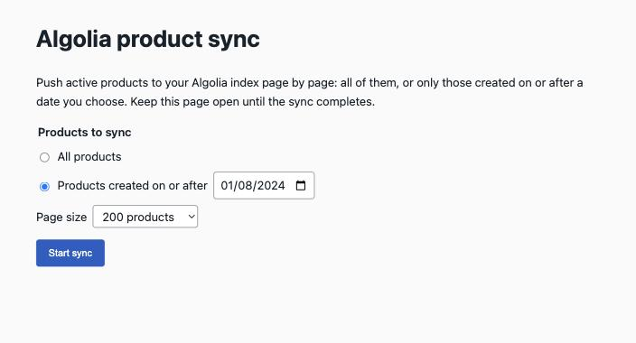
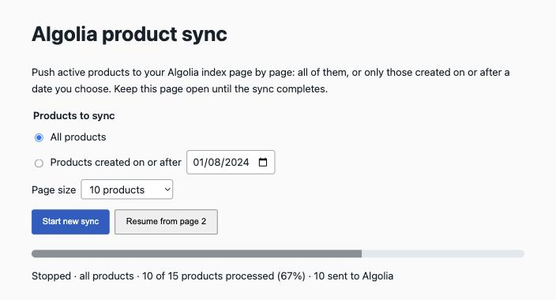
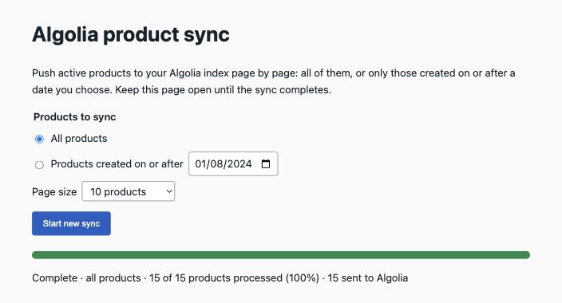
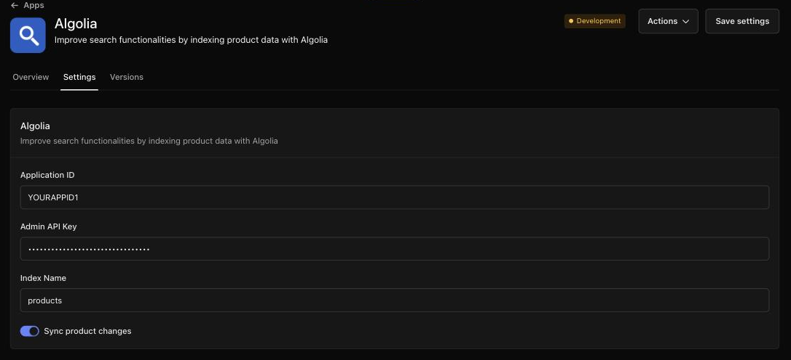

# Algolia for Swell

App ID: `algolia` · Type: integration · Frontend: managed by Swell (React + Vite on Cloudflare Workers)

## What the app does

Algolia for Swell copies your products into [Algolia](https://www.algolia.com), a hosted search service, so your storefront can offer fast, typo-tolerant search with filters by category. Once it is connected to your Algolia account, every product you create, edit, deactivate or delete in Swell is updated in Algolia automatically. When you first connect, or whenever you want to refresh the index, you can push your whole catalog (or only products created after a date) from a page in the Swell dashboard and follow its progress.


## Features

### 1. Automatic product updates

**What it does.** Sends product changes to Algolia as they happen:

| Change in Swell | Result in Algolia |
|---|---|
| Active product created or updated | The product is read with the indexed fields and saved to the index. An existing record with the same ID is replaced. |
| Product updated to inactive | Its record is deleted from the index. |
| Product deleted | Its record is deleted from the index. |

**Where it shows up.** Nowhere in the dashboard: it runs in the background. It can be turned off with the **Sync product changes** setting.

**Implemented by.**
- Function `functions/product-events.ts`, a model trigger on the events `product.created`, `product.updated` and `product.deleted`.
- Shared code in `functions/lib/algolia.ts`: `getAlgoliaSettings`, `formatProduct`, `saveObject`, `deleteObject`.
- Algolia 4xx errors (wrong key, oversized record) are raised as `SwellError` with `retry: false`, so the event is not retried. 5xx and network errors are rethrown so Swell can retry the event.

### 2. Product sync page

**What it does.** Pushes products to Algolia on demand, page by page:

- **Products to sync:** **All products**, or **Products created on or after** a date. The date is the start of that day in the merchant's time zone, compared with the product's `date_created`.
- **Page size:** 10, 100 (default), 200, 500 or 1000 products per request. 1000 is the Swell API maximum.
- Products are pushed oldest first. The page shows a progress bar, how many products were processed and how many were sent to Algolia.
- **Stop** finishes the page in flight, then stops. **Resume from page N** continues a stopped or failed sync with the same filter and page size. The form is locked while a sync runs.
- The first page checks that the Algolia credentials work before anything is pushed.
- If a request fails, the page shows the error and an **Error details** block: the failing step (`sync`, `swell api`, `algolia` or `validate admin session`), HTTP status and upstream response, with credentials removed.

**Where it shows up.** Dashboard sidebar: **Products → Algolia sync**. The page opens inside the dashboard.







**Implemented by.**
- Content view `content/syncs.json`: a list view with `nav: { parent: "products", label: "Algolia sync", link: "frontend:///" }`, which adds the sidebar entry and opens the app frontend.
- Data model `models/syncs.json`: an empty placeholder collection. It stores no records; the dashboard only shows a content view's sidebar entry when a model exists for its collection.
- Frontend page `frontend/src/ProductSync.tsx`.
- Frontend Worker endpoint `POST /app-api/admin/sync` in `frontend/worker/swell-server.ts`. It checks the staff session and runs `syncProductsPage` from `functions/lib/algolia.ts` for one page per request. See [How the product sync works](#how-the-product-sync-works).
- Function `functions/sync-products.ts`: a private `POST` route that syncs one page with the same code, for the CLI and automation. The sync page does not use it.

### 3. Search records for the storefront

**What it does.** Turns each active product into one Algolia record that a storefront search can query and filter:

- `objectID`: the Swell product ID.
- Product fields: `name`, `description`, `content`, `meta_description`, `price`, `orig_price`, `currency`, `sku`, `slug`, `images` (id, caption, file url, width, height), `stock_status`, `stock_tracking`, `stock_purchasable`, `bundle`, `attributes`.
- `categories`: the full path of every category the product is in, for example `" Clothing  >  Shirts "`, for category filters.
- `<Category>lvls`: hierarchical levels (`lvl0`, `lvl1`, …) of each nested category, for Algolia's hierarchical menu widget.
- `bundle_items`: `{ quantity, name }` of each bundled product.
- Translations: when the store has several locales, localized values are added as `<field>_<locale>` (for example `name_fr`), and `meta_title`, `meta_description` and `tags` are left out.

**Where it shows up.** In the merchant's Algolia index (default name `products`). The app does not add search to the storefront: the storefront queries Algolia itself, for example with Algolia InstantSearch and a Search-Only API key.

**Implemented by.** `functions/lib/algolia.ts`: `PRODUCT_QUERY` (fields read from Swell), `getCategoryLookup` (category paths), `formatProduct` (record shape) and `saveObjects` (Algolia batch API). Both features above use it.

### 4. App settings

**What it does.** Stores the Algolia credentials, the index name and the automatic-updates switch. See [Setup](#setup) for each setting.

**Where it shows up.** **Apps → Algolia → Settings**.



**Implemented by.** `settings/algolia.json`. Functions and the Worker read it with `swell.settings()`, which calls `GET /settings/algolia`.

The app has no webhooks and no notifications.

## Setup

### What you need from Algolia

- An Algolia account and an application. Algolia creates the index automatically on the first write.
- The application's **Application ID** and **Admin API Key**, from Algolia → **Settings → API Keys**. It has to be the Admin key: the sync checks the key by listing API keys, which a Search-Only or custom write key cannot do.

### Install and configure

1. Install **Algolia** from **Apps** in the Swell dashboard. While the app is in development, `swell app push` installs it in the test environment of the store the CLI is using.
2. Open **Apps → Algolia → Settings**, fill in the settings below and click **Save settings**.
3. Open **Products → Algolia sync**, choose **All products** and click **Start sync**. Keep the page open until it shows **Complete**.

| Setting | ID | Default | What it does |
|---|---|---|---|
| Application ID | `api_application_id` | none, required | Algolia application to write to. |
| Admin API Key | `api_admin_key` | none, required | Algolia Admin API key. Used only on Swell's servers to write to the index; never sent to the browser. |
| Index Name | `index_name` | `products` | Algolia index that receives product records. An empty value falls back to `products`. |
| Sync product changes | `enabled` | on | Sends product create, update and delete events to Algolia. The product sync page works either way. |

Credentials and options live only in settings, never in code.

## Day-to-day use

- **Nothing to do for normal changes.** With **Sync product changes** on, products you add, edit, deactivate or delete are updated in Algolia within moments.
- **After bulk changes** (an import, or edits made while **Sync product changes** was off), open **Products → Algolia sync** and run a sync. To refresh only recent products, choose **Products created on or after** and a date.
- **Large catalogs:** a larger page size (500 or 1000) needs fewer requests. If a page fails, for example because records are large, start a new sync with a smaller page size.
- **If a sync stops or fails,** read the error details, fix the cause (usually the settings), and click **Resume from page N**.
- **Changed index or credentials?** Save the new settings and run a full sync so the new index has every product.

## Limits and known issues

**What it does not do**
- It does not add search to the storefront; the storefront queries Algolia directly.
- Only active products are indexed. Variants, categories, content pages and other records are not indexed as their own records.
- It does not remove records that are already in the index but no longer exist in Swell (for example after changes made while **Sync product changes** was off). A full sync overwrites existing records but does not delete extra ones. To clean up, clear the index in Algolia, then run a full sync.
- It does not configure Algolia searchable attributes, facets or ranking; set those up in the Algolia dashboard.

**Rate limits and sizes**
- Algolia plan limits apply: record size (for example 10 KB per record on the free plan) and monthly operations. Every automatic update and every synced product counts as an Algolia operation.
- The sync sends one request at a time and at most 1000 products per request, the Swell API maximum.
- The managed frontend package limit is 8 MiB; the app uses about 0.3 MB.

**Environments**
- Settings and the installation are per environment (test and live). `swell app push` deploys to the test environment only; the app has so far been developed and tested in test environments (onixo and the local dev3 platform), not in a live environment.
- The sync page needs Swell's managed frontend hosting. On a local development platform (for example `*.swell.test`), the app frontend also needs local DNS for its host and public tunnels so Cloudflare can reach the local API; see [Local development platform](#local-development-platform).

**Conflict with the built-in Algolia integration**
- Swell also has a built-in Algolia integration (**Integrations → Algolia**). Running it together with this app sends the same products to Algolia twice, which doubles Algolia operations, and the two can overwrite each other's records if they use the same index. Use only one of them.
- The `"integrations": ["algolia"]` field in `swell.json` makes Swell show a dialog for resolving conflicts when the app is installed.

**Known issues**
- **The manual sync runs in the browser.** Closing or reloading the page stops it after the current page. Nothing runs in the background.
- **Any staff user** who can open the page can run a sync; there is no separate permission.
- **Changes during a sync:** new products land on later pages (oldest-first order) and are included. Deleting or deactivating a product during a sync can shift later products back by one, so one product may be skipped until its next update or the next sync.
- **Legacy record quirks, kept on purpose:** category paths have extra spaces (`" Clothing  >  Shirts "`), and fields whose value is `0`, `false` or empty are left out of records. Changing either would change facet values in existing indexes.


## Development

### Requirements

- Node.js 22.22.2 or later and npm.
- Swell CLI (`@swell/cli`), logged in with `swell login` to a store with a test environment. `swell switch <store>` changes the store that CLI commands use.

### Layout

```
swell.json                 App manifest: id, frontend hosting, screenshots ("images")
DESCRIPTION.md             App description shown to merchants (marketplace listing)
settings/algolia.json      Merchant settings
functions/
  product-events.ts        Automatic product updates (model events)
  sync-products.ts         Private route: sync one page (CLI and automation)
  lib/algolia.ts           Shared code: settings, Algolia REST client, record format, page sync
models/syncs.json          Empty placeholder model behind the sidebar entry
content/syncs.json         Sidebar entry Products → Algolia sync, opens the frontend
frontend/                  Managed frontend (see frontend/README.md)
  src/ProductSync.tsx      Sync page
  worker/swell-server.ts   Worker endpoint POST /app-api/admin/sync
test/
  unit/                    Unit tests with mocked Swell and Algolia
  integration/             Read-only tests against your store's test environment
  helpers/                 Mock request, Swell client and fetch helpers
assets/icon.png            App icon (placeholder)
assets/screenshots/        Screenshots listed in swell.json "images"
```

### Run

```sh
npm install        # installs the app and the frontend workspace
swell app push     # deploys to the test environment of the current CLI store
```

Then open the dashboard in test mode: **Products → Algolia sync** for the sync page, and edit a product to trigger an automatic update. `cd frontend && npm run dev` starts Vite locally, but without Swell's request context the sync endpoint cannot reach a store, so test the page in the store after pushing.

### Test

| Command | What it runs |
|---|---|
| `npm test` | All vitest tests, unit and integration. |
| `npx vitest run test/unit` | Unit tests only; no network or login needed. |
| `cd frontend && npm test` | The Worker endpoint tests. |
| `npm run typecheck` | TypeScript for functions, tests and the frontend. |
| `cd frontend && npm run lint` | ESLint for the frontend. |

- **Unit tests** cover both functions, the shared lib (settings, Algolia client with host fallback and error handling, record format, category tree, page sync) and the Worker endpoint. Swell is mocked with `createMockRequest`, and `fetch` is stubbed for Algolia and platform calls.
- **Integration tests** are read-only. They use your Swell CLI session to read app settings, locales, categories and products from the test environment of your current store, and never write to Swell or Algolia.
- In CI, set `SWELL_STORE_ID` and `SWELL_SESSION_ID` (optionally `SWELL_API_BASE_URL`) instead of `swell login`.

### Push

- `swell app push` deploys every changed file and always rebuilds and deploys the frontend. `swell app push <file-or-folder>` pushes only that path, for example `swell app push assets`.
- `swell inspect content app.algolia.syncs` shows the deployed sidebar entry.
- `swell api post /functions/algolia/sync-products --body '{"page":1,"limit":100}'` syncs one page from the CLI. Add `"created_after":"2026-01-01T00:00:00Z"` to filter. **This writes to Algolia.**
- `swell app version` and `swell app release` publish the app; agree on them with the app owner first.

### How the product sync works

1. The sync page calls `POST /app-api/admin/sync` with `{ page, limit, created_after? }` for page 1, 2, 3… until the response says `done`.
2. The Worker accepts only same-origin JSON requests (CSRF protection) and validates the `_swell_admin_session` cookie with Swell, requiring a staff session of the same store.
3. It runs `syncProductsPage` with the Backend API credentials that Swell passes to the Worker in request headers, the same credentials app functions get.
4. It returns only `{ page, limit, count, synced, done }`, or `{ error, details }` with the access token redacted.

The Worker runs the sync itself instead of calling `sync-products`: the Backend API has no `/functions/<app>/<name>` route, and calling a function through its `:functions` record returns no result with the app's access token.

### Local development platform

On a local Swell platform (for example `dev3.swell.test`), the app frontend loads only when:
- the host `<store>--<installation-id>--app.swell.test` resolves to `127.0.0.1` (a hosts entry or a dnsmasq wildcard for `swell.test`);
- `APP_FUNCTIONS_API_URL` and `APP_ADMIN_API_URL` in swell-admin's `.env.local` are public tunnels to the local API and admin, because the frontend Worker and the functions run on Cloudflare;
- swell-admin's `MANAGED_FRONTEND_SIGNING_KEY` matches the dev dispatcher's `SIGNING_KEY`.

### Notes

- Keep `frontend/dist/`, `frontend/.wrangler/` and `*.tsbuildinfo` out of git: builds write local absolute paths into them. `swell app push` skips them and rebuilds the frontend.
- The allowed page sizes are `PAGE_SIZES` and `DEFAULT_PAGE_SIZE` in `functions/lib/algolia.ts`. Keep the copy in `frontend/src/ProductSync.tsx` in step; the server rejects other values.
