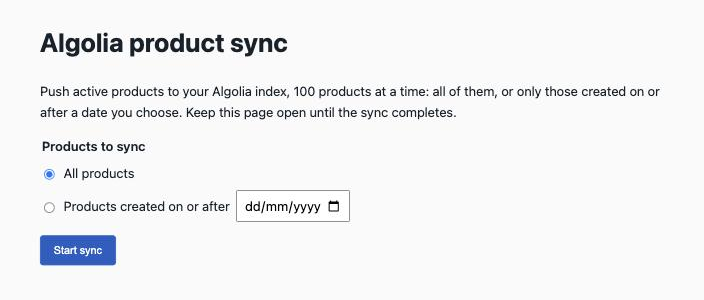

# Algolia for Swell

Index your Swell products in [Algolia](https://www.algolia.com) for fast storefront search. The app keeps the index up to date as products change, and gives merchants a page in the Swell dashboard to push the whole catalog (or only recent products) on demand.

App ID: `algolia` · Type: integration · Frontend: managed by Swell (React + Vite on Cloudflare Workers)

This is a port of the legacy Swell Algolia integration. Records keep the legacy shape so existing Algolia indexes, facets and storefront queries keep working.

## Features

### Real-time product updates

The `product-events` function runs on every `product.created`, `product.updated` and `product.deleted` event:

| Event | What happens in Algolia |
|---|---|
| Product created or updated (active) | The product is read with the indexed fields and saved to the index (`updateObject`, so existing records are replaced). |
| Product updated to inactive | The record is deleted from the index. |
| Product deleted | The record is deleted from the index. |

- Turn this off with the **Sync product changes** setting. A manual sync still works when it is off.
- Products the active-products query does not return are skipped.
- Algolia 4xx errors (for example a wrong key or an oversized record) are marked as not retryable. 5xx and network errors are rethrown so the event can be retried.

### Manual product sync

**Products → Algolia sync** in the dashboard opens the app page:



- **All products**, or **Products created on or after** a date. The date is the start of that day in the merchant's time zone, compared with `date_created`.
- **Page size**: 10, 100 (default), 200, 500 or 1000 products per request. Larger pages mean fewer requests; smaller pages give finer progress and smaller requests if records are large. 1000 is the Swell API maximum.
- Products are pushed page by page, oldest first, and the page shows a progress bar, the count processed and the count sent to Algolia.
- **Stop** finishes the page in flight and stops. **Resume from page N** continues from where a stopped or failed sync left off, with the same filter and page size (the form is locked while a sync runs).
- On failure, the page shows the error message and an **Error details** block (the failing step, HTTP status and upstream response) to help diagnose settings, Swell API or Algolia problems.
- The first page checks that the Algolia credentials can access the index before pushing anything.

### Record format

Each product becomes one Algolia record:

- `objectID`: the Swell product ID.
- Product fields: `name`, `description`, `content`, `meta_description`, `price`, `orig_price`, `currency`, `sku`, `slug`, `images` (id, caption, file url/width/height), `stock_status`, `stock_tracking`, `stock_purchasable`, `bundle`, `attributes`.
- `categories`: the full path of every category the product is in, for example `" Clothing  >  Shirts "`. The legacy integration's spacing is kept on purpose so existing facets keep matching.
- `<Category>lvls`: hierarchical levels (`lvl0`, `lvl1`, …) for each nested category, for Algolia's hierarchical menu widget.
- `bundle_items`: `{ quantity, name }` of each bundled product.
- Translations: when the store has locales, localized values are flattened into `<field>_<locale>` (for example `name_fr`), and `meta_title`, `meta_description` and `tags` are dropped.
- Empty and falsy values are omitted (as in the legacy integration), so fields that are `0`, `false` or empty strings do not appear on the record.

## Settings

Merchants set these under **Apps → Algolia → Settings**. Credentials and options live only in settings, never in code.

| Setting | ID | Default | Description |
|---|---|---|---|
| Application ID | `api_application_id` | — (required) | Algolia application ID, from Algolia → Settings → API Keys. |
| Admin API Key | `api_admin_key` | — (required) | Algolia **Admin** API key. Used only server-side to write to the index. The sync checks the key by listing API keys, which only the Admin key can do; a Search-Only key is rejected. |
| Index Name | `index_name` | `products` | Algolia index that receives product records. An empty value falls back to `products`. |
| Sync product changes | `enabled` | on | Send product create, update and delete events to Algolia. Does not affect the manual sync. |

## Setup

1. Install the app in the Swell store.
2. In Algolia, open **Settings → API Keys** and copy the Application ID and the Admin API Key.
3. In Swell, open **Apps → Algolia → Settings**, enter the Application ID and Admin API Key, and optionally change the index name. Save.
4. Open **Products → Algolia sync**, choose **All products** and click **Start sync**. Keep the page open until it shows **Complete**.
5. From now on, product changes are sent to Algolia automatically.

## Limits and behavior to know

- **Only active products** are indexed. Deactivating a product removes it from the index.
- **The manual sync runs in the browser.** Closing or reloading the page stops it after the current page; use **Resume** to continue. Nothing runs in the background.
- **Any staff user of the store** who can open the app page can run a sync.
- **Changes during a sync:** new products go to later pages (oldest-first order), so they are included. Deleting or deactivating a product during a sync can shift the remaining products by one, so one product may be skipped; real-time updates or a new sync cover it.
- **Algolia limits apply:** record size (10 KB per record on some plans) and operation quotas. Oversized records fail with Algolia's message in the error details.
- The app has an empty `syncs` data model. It stores no records; it only exists so the dashboard shows the **Algolia sync** sidebar entry, which requires a model behind the content view.

## Development

### Requirements

- Node.js 22.22.2 or later and npm.
- Swell CLI (`@swell/cli`), logged in to a store with a test environment: `swell login`.

### Layout

```
swell.json                 App manifest (id, frontend hosting, screenshots)
settings/algolia.json      Merchant settings (credentials, index, events toggle)
functions/
  product-events.ts        Real-time updates on product events
  sync-products.ts         Private route: sync one page (for the CLI and automation)
  lib/algolia.ts           Shared code: settings, Algolia REST client, product formatting, page sync
models/syncs.json          Placeholder model for the sidebar entry
content/syncs.json         Sidebar entry Products → Algolia sync, links to the frontend
frontend/                  Managed frontend (React page + Worker endpoint)
  src/                     Sync page (ProductSync.tsx)
  worker/                  Worker: POST /app-api/admin/sync
test/
  unit/                    Unit tests with mocked Swell and Algolia
  integration/             Read-only tests against your store's test environment
  helpers/                 Mock request, Swell client and fetch helpers
assets/icon.png            App icon (placeholder)
assets/screenshots/        Screenshots listed in swell.json "images"
```

### How the manual sync works

1. The sync page calls `POST /app-api/admin/sync` with `{ page, limit, created_after? }` for page 1, 2, 3… until the response says `done`. `limit` must be one of 10, 100, 200, 500, 1000 (default 100).
2. The Worker (`frontend/worker/swell-server.ts`) accepts only same-origin JSON requests (CSRF protection) and validates the `_swell_admin_session` cookie against Swell, requiring a staff session of the same store.
3. It then runs `syncProductsPage` from `functions/lib/algolia.ts` with the Backend API credentials Swell passes to the Worker in request headers. These are the same credentials app functions get.
4. It returns only `{ page, limit, count, synced, done }`, or `{ error, details }` with the access token redacted.

The Worker runs the sync itself instead of calling the `sync-products` function: the Backend API has no `/functions/<app>/<name>` route, and invoking functions through their `:functions` record does not return results with the app's access token.

### Commands

Run from the app root unless noted.

| Command | What it does |
|---|---|
| `npm install` | Installs the app and the `frontend` workspace. |
| `npm run typecheck` | Type-checks functions, tests and the frontend. |
| `npm test` | Runs all vitest tests (unit and integration). |
| `npx vitest run test/unit` | Unit tests only; no network or login needed. |
| `cd frontend && npm run lint` | Lints the frontend. |
| `cd frontend && npm test` | Runs the Worker endpoint tests. |
| `cd frontend && npm run build` | Builds the frontend locally (push builds it anyway). |
| `swell app push` | Deploys everything to the store's test environment, including a fresh frontend build. |
| `swell inspect content app.algolia.syncs` | Shows the deployed sidebar entry. |
| `swell api post /functions/algolia/sync-products --body '{"page":1}'` | Syncs one page from the CLI. Add `"limit":500` for the page size and `"created_after":"2026-01-01T00:00:00Z"` to filter. **Writes to Algolia.** |

### Tests

- **Unit tests** (`test/unit/`) cover both functions, the shared lib (settings, Algolia client with host fallback and error handling, record formatting, category tree, page sync) and the frontend Worker endpoint. Swell is mocked with `createMockRequest`, and `fetch` is stubbed for Algolia and platform calls.
- **Integration tests** (`test/integration/`) are read-only: they use your Swell CLI session to read app settings, locales, categories and products from the test environment of your default store. They never write to Swell or Algolia.
- In CI, set `SWELL_STORE_ID` and `SWELL_SESSION_ID` (and optionally `SWELL_API_BASE_URL`) instead of relying on `swell login`.

### Testing in a store

1. `swell app push` to deploy to the test environment.
2. Open the dashboard in test mode and go to **Products → Algolia sync**.
3. For product events, create, edit, deactivate or delete a product in the test environment and check the Algolia index.

### Notes

- Keep `frontend/dist/` and `frontend/.wrangler/` out of git. Builds write local absolute paths into them. `swell app push` ignores them and always rebuilds the frontend.
- The managed frontend package is limited to 8 MiB; the app currently uses about 0.3 MB.
- `PAGE_SIZES` and `DEFAULT_PAGE_SIZE` in `functions/lib/algolia.ts` set the allowed page sizes; keep `PAGE_SIZES` in `frontend/src/ProductSync.tsx` in sync with them.
